# Assignment 4. Forms and Validation

**Name:** Almansur Maxym
**Group:** IT-2501

## Project structure

- `index.html` – one page with all tasks
- `style.css` – custom styles
- `script.js` – Bootstrap validation for Task 3 and Task 4
- `screenshots/` – screenshots for the report

---

## Part 1. Basic HTML Forms

### Task 0. Simple Contact Form
Create a basic contact form with Name, Email, Message and a Submit button. All fields must have proper `<label>` elements.

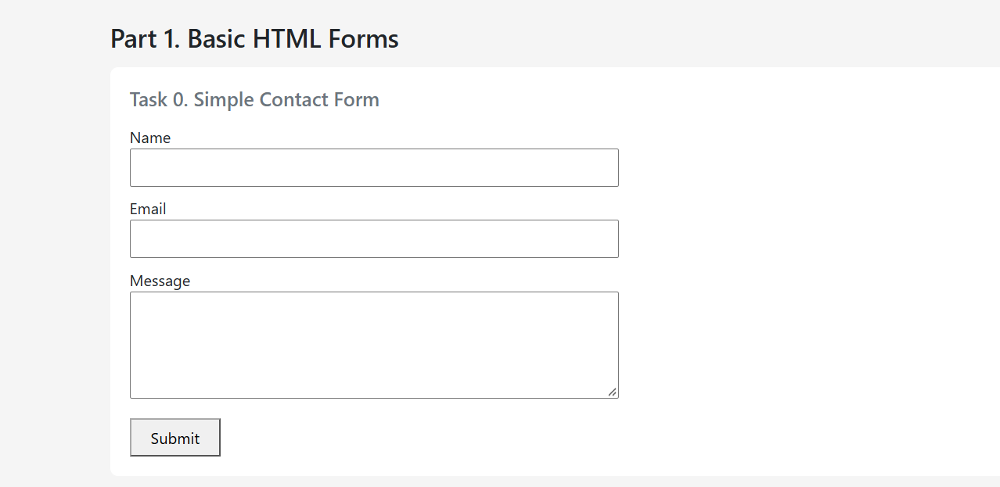

### Task 1. Form with HTML5 Validation
Add built-in validation attributes (required, type, maxlength, etc.) and test how the browser enforces validation.

**Empty field**
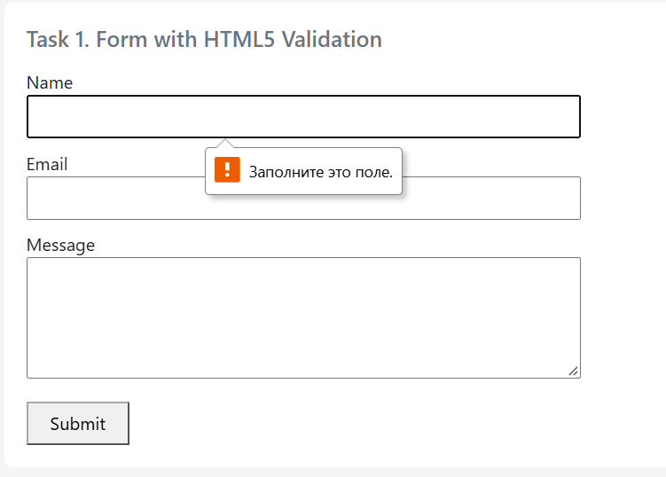

**Wrong email format**
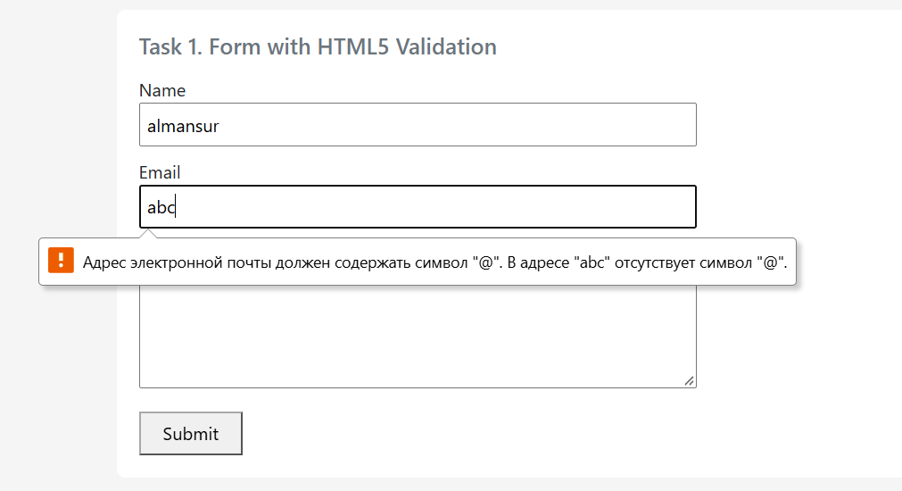

---

## Part 2. Bootstrap Forms

### Task 2. Bootstrap Form Styling
Recreate the contact form using Bootstrap form classes and grid system. Add placeholders and helper text.

**Desktop**
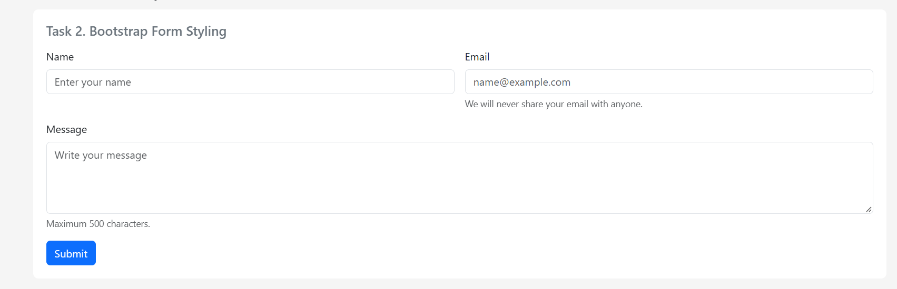

**Mobile**
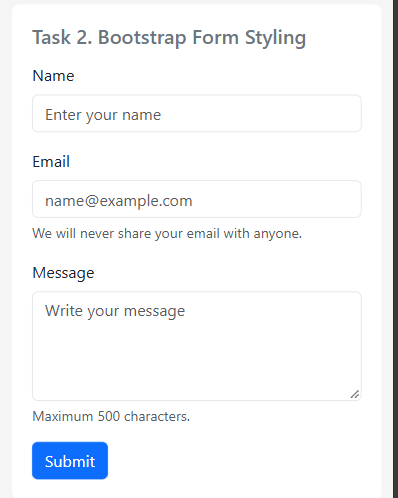

### Task 3. Bootstrap Validation Styles
Apply Bootstrap validation classes (is-valid, is-invalid) and show feedback messages below inputs.

**Invalid data**
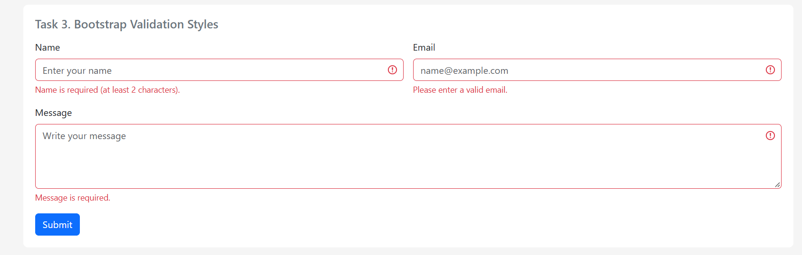

**Valid data**
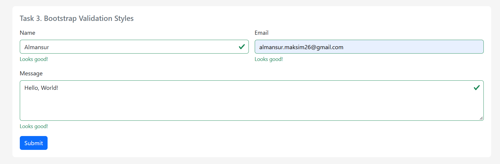

---

## Part 3. Advanced Form Project

### Task 4. Registration Form
Create a registration form with First Name, Last Name, Email, Password, Confirm Password, Gender, Hobbies, Country, Submit and Reset buttons. Use Bootstrap grid, HTML5 validation and Bootstrap validation feedback.

**Desktop**
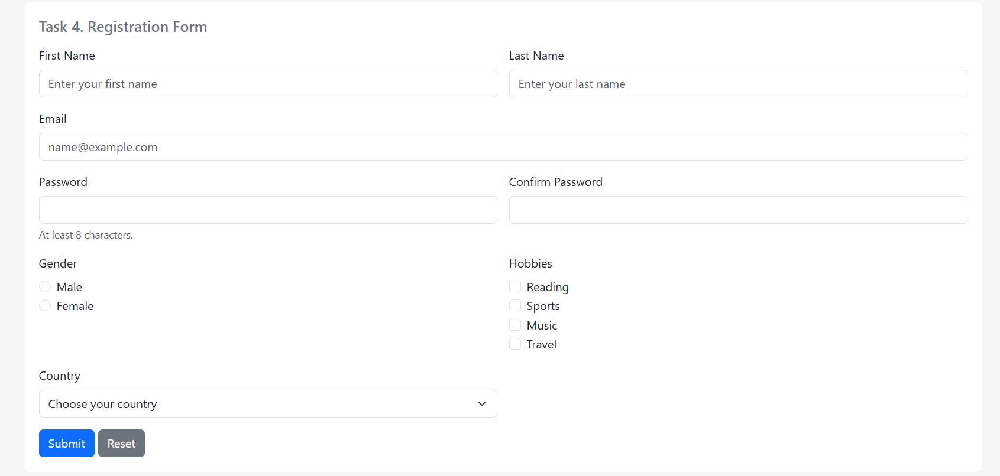

**Mobile**
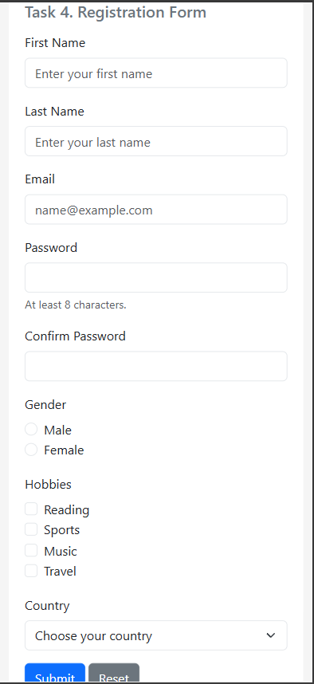

**Invalid data**
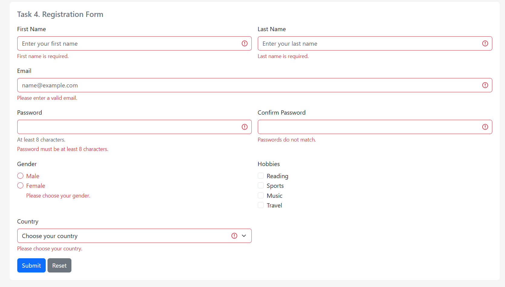

**Passwords do not match**
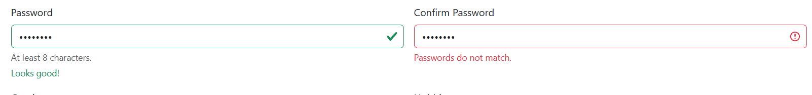

**Valid data**
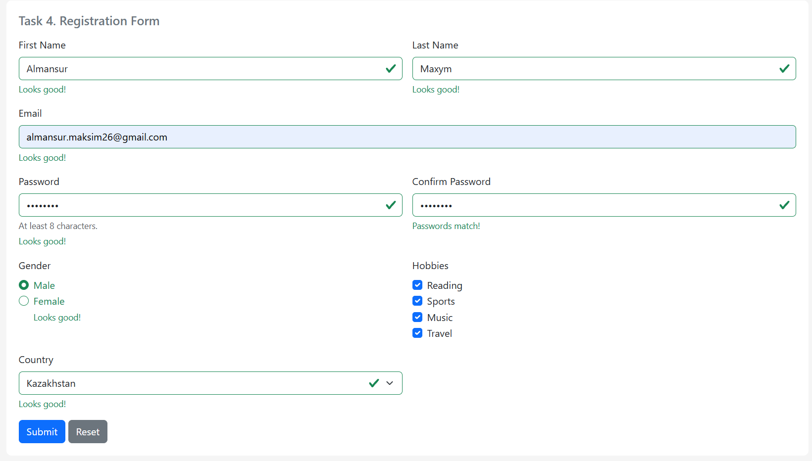

---

## Summary of work process

For this assignment, I put all 5 tasks on one page (`index.html`) so it is easier to scroll through and compare standard HTML forms with Bootstrap ones.

In the first part, I set up a simple form and added HTML5 validation attributes (`required`, `minlength`, `maxlength`, `type="email"`) to see how Chrome blocks invalid submissions out of the box. In the second part, I switched to Bootstrap's grid (`col-12 col-md-6`) for responsiveness and added custom `.valid-feedback` and `.invalid-feedback` blocks. Since Bootstrap needs JavaScript to show these messages, I disabled default browser tooltips with `novalidate` and wrote a small script using `checkValidity()` to toggle `.is-valid` and `.is-invalid` classes on submit.

In the last part, I assembled the full registration form. Besides standard required fields, I used `setCustomValidity()` in `script.js` to compare the two password inputs, and hooked up the Reset button so it also clears the green/red validation borders. Tested both layouts using Chrome DevTools device toolbar.